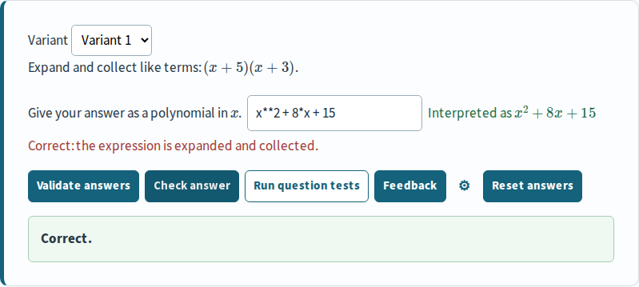
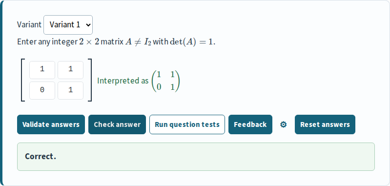

::: {.lead}
**Accepted milestone 2 baseline.** The same 19 question cards and 27 frozen variants run through CTM’s existing frontend with either backend. Both pass all **121 authored test rows**, with **zero structured-result differences**.
:::

The hybrid Maxima backend establishes compatibility for this curated question set: Python handles validation and response-tree control, while Maxima runs ordinary STACK answer tests. The separate native path prepares and validates questions in Maxima and loads Python only when a visited PythonChecker node needs it. These paths do not establish a general performance advantage.

[View PR #1](https://github.com/Erasmus-CTM/stack-wasm-maxima/pull/1){.primary-link}
[Inspect the accepted browser run](https://github.com/Erasmus-CTM/stack-wasm-maxima/actions/runs/39721228518){.secondary-link}

## Try the live exercises

Open the same examples with either assessment backend. These are the actual CTM question cards: enter an answer, select **Validate**, then **Check** to assess it. Use the variant selector and **Reset** to explore another case. **Run question tests** executes the authored test cases and shows their results.

| Backend | Start with one question | Explore the full examples |
|---|---|---|
| SymPy | [Open SymPy question](sympy/index.html) | [Open SymPy examples](sympy/examples.html) |
| Hybrid Maxima | [Open Maxima question](maxima/index.html) | [Open Maxima examples](maxima/examples.html) |

::: {.exercise-note}
On your first visit, the page reloads once to prepare the assessment environment. The first assessment then loads its browser runtime. In the milestone 2 baseline, Maxima took about 25 seconds to initialize on the CI runner; public-network loading can take longer. Keep the page open while it loads. The hybrid Maxima examples use native STACK answer tests alongside CTM’s Python validation, PRT orchestration and PythonChecker.
:::

Read [Data flow](maxima/data-flow.html) to follow an answer through typed or graphical input, validation, native grading and optional PythonChecker callbacks. Developer diagrams show which component handles each step.

## Native questions and graphical answers

The [native exercise page](maxima/native.html) adds **9 playable cards, 11 variants
and 24 authored test rows**. It uses native STACK preparation, input validation
and response trees, the existing JSXGraph Quarto renderer, and optional PythonChecker
callbacks. The page clearly distinguishes unchanged upstream examples,
CTM-authored standard questions and CTM extensions.

The [accepted milestone 3 run](https://github.com/Erasmus-CTM/stack-wasm-maxima/actions/runs/39823225049)
passed the full browser checks and independent replay of **316 generated programs**:
307 matched exactly and 9 had narrowly classified display-only differences;
there were no unaccepted differences. Its published pages also passed the real
browser checks against that exact build. This evidence describes source
`15fa33299d68d64e122a2661a2868feb30130edb`; later documentation and timing reports
are separate from that tested snapshot.

[Review milestone 3 PR](https://github.com/Erasmus-CTM/stack-wasm-maxima/pull/2){.primary-link}

## What was compared in milestone 2

Both editions use the same pinned documentation questions, options, variants and rendered payloads. The question renderer, scalar and matrix editors, controls, feedback and PythonChecker remain in the CTM libraries. Backend selection is per page.

| Responsibility | SymPy edition | Hybrid Maxima edition |
|---|---|---|
| Ordinary answer-test verdicts | SymPy | Native STACK answer tests in Wasm Maxima |
| Question preparation, parsing and validation | CTM / Pyodide | CTM / Pyodide |
| PRT orchestration and PythonChecker | CTM / Pyodide | CTM / Pyodide |
| Student controls and question display | Existing CTM frontend | Existing CTM frontend |

Maxima verdicts remain authoritative. The hybrid adapter does not fall back to SymPy answer tests. Collection feedback combines native diagnostics with bounded CTM formatting, guarded against disagreement with the native verdict.

## Milestone 2 correctness and coverage

| Browser check | SymPy | Hybrid Maxima |
|---|---:|---:|
| Question cards | 19 | 19 |
| Completed frozen variants | 27 | 27 |
| PythonChecker cards | 6 | 6 |
| Passed authored test rows | 121 / 121 | 121 / 121 |
| Selected student-input validations | 27 | 27 |
| Repeated grading calls | 81 | 81 |
| Reset checks | 27 | 27 |
| Stale validation-reply checks | 2 | 2 |

Every authored row runs through the existing **Run question tests** control. One selected authored answer per variant is also entered through the actual student editors, validated and graded three times. This does not imply that every wrong or invalid authored answer was entered through those editors.

The comparison retains scores, status, input interpretations, PRT paths, answer notes, feedback and PythonChecker assessment data. There were no operation, network, UI-state or routing failures in the accepted run. Instrumentation recorded 232 native Maxima answer-test events and 122 PythonChecker events, linked to the actual requests.

## Historical milestone 2 performance

| Measurement | SymPy | Hybrid Maxima |
|---|---:|---:|
| Worker initialization, two pages | 3.55–3.58 s | 24.74–26.10 s |
| Median warm validation | 14.2 ms | 14.2 ms |
| Median warm grading | 14.5 ms | 35.1 ms |
| Encoded response bodies per fresh page | 10.50–10.52 MB | 21.21–21.28 MB |

The run used Chromium 141.0.7390.37, a fresh context and cache for each page, and prepared local assets served with gzip and isolation headers. MB means 1,000,000 bytes; transfer counts exclude protocol and header overhead. Warm medians combine the matching ordinary and PythonChecker question mix.

These are observations from one accepted CI run, not public-network latency, a full-course package measurement or a statistically powered benchmark. Startup varied across earlier runs. Memory was not measured. Both editions still load Pyodide and SymPy; the hybrid adds another interpreter and its initialization work.

## The same student interface

The accepted artifact contains scalar and matrix screenshots from each backend, taken after the timed grading calls. Corresponding screenshots are byte-identical for each question kind. The images below show the Maxima edition.

{fig-alt="CTM scalar question with an interpreted expression, a full-credit result and question controls."}

{fig-alt="CTM matrix editor showing a full-credit PythonChecker result and validation and grading controls."}

The live exercise pages above use the rendered site from the accepted Actions artifact. Both editions retain its questions and grading code. A small service worker prepares the browser isolation required by Maxima’s shared-memory worker.

## Reproduce and inspect

The accepted execution tested source [`2493268c2bf3eb9941407f376d20a07fb5da4ec9`](https://github.com/Erasmus-CTM/stack-wasm-maxima/commit/2493268c2bf3eb9941407f376d20a07fb5da4ec9) in a clean worktree. Later report and publication changes are separate from that measured source. Earlier failed runs remain archived.

- [Build guide and pinned-source instructions](https://github.com/Erasmus-CTM/stack-wasm-maxima/blob/research/2026-10-runtime-feasibility/prototype/README.md)
- [Raw accepted browser report](https://github.com/Erasmus-CTM/stack-wasm-maxima/blob/research/2026-10-runtime-feasibility/reports/milestone-two/runs/39721228518/browser.json)
- [Accepted computed summary](https://github.com/Erasmus-CTM/stack-wasm-maxima/blob/research/2026-10-runtime-feasibility/reports/milestone-two/runs/39721228518/latest.json)
- [Completion report and screenshot files](https://github.com/Erasmus-CTM/stack-wasm-maxima/blob/research/2026-10-runtime-feasibility/reports/milestone-two/2026-10-22-completion.md)
- [Quarto source for this page](https://github.com/Erasmus-CTM/stack-wasm-maxima/blob/research/2026-10-runtime-feasibility/comparison/index.qmd)

The accepted artifact is named `milestone-two-2493268c2bf3eb9941407f376d20a07fb5da4ec9`. Its ZIP SHA-256 is `bee2255220f31b3e4b681cce6baa170c01ee843d36818bd239baddf52b92e7e1`. The artifact contains the rendered demo, diagnostics and four screenshots. Artifacts may expire; reports and screenshots are also committed to the repository.

## What remains

The native page documents a bounded input/controller and feedback subset; it does
not claim full Moodle PHP controller or attempt-state compatibility. Broader
compatibility, cancellation, additional browser engines, memory measurements,
production CTM integration, course defaults and offline/exam packaging remain
later work. The comparison page already supports both backends on one page.

::: {.page-footer}
Erasmus CTM · Browser STACK feasibility study · Evidence recorded 22 October 2026
:::
